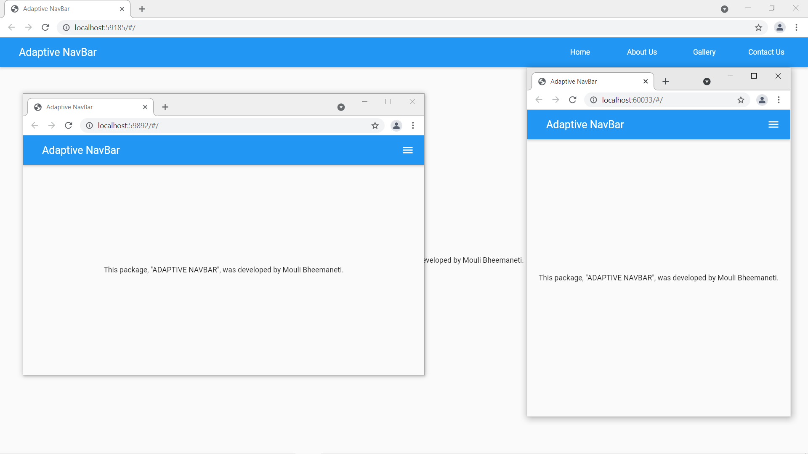

# Adaptive NavBar (adaptive_navbar)

[](https://github.com/moulibheemaneti/adaptive_navbar/issues)
[](https://github.com/moulibheemaneti/adaptive_navbar/network)
[](https://github.com/moulibheemaneti/adaptive_navbar/stargazers)
[](https://github.com/moulibheemaneti/adaptive_navbar/blob/master/LICENSE)



## Table of contents
* [General info](#general-info)
* [Setup](#setup)
* [Conclusion](#conclusion)
* [Useful Resources](#useful-resources)
* [Meet the developer](#meet-the-developer)

## General info
**adaptive_navbar** is a flutter package which helps to create a adaptive navbar which is screen friendly for all the different device aspect ratios. This package can be easily added to your flutter projects. This make your works simpler and your code shorter.
	
## Setup
These are the steps on how to use this package.

#### Run this command:

```
$ flutter pub add adaptive_navbar
```

This will add a line like this to your package's pubspec.yaml (and run an implicit flutter pub get):
```yaml
dependencies:
  adaptive_navbar: ^2.0.0 #check for latest in versions at https://pub.dev/packages/adaptive_navbar/versions
```
Check for latest in versions at https://pub.dev/packages/adaptive_navbar/versions.

Alternatively, your editor might support or flutter pub get. Check the docs for your editor to learn more.

#### Import it
Now in your Dart code, you can use:
```dart
import 'package:adaptive_navbar/adaptive_navbar.dart';
```

## Requirements

From 2.0.0, `adaptive_navbar` is built on [`material_ui`](https://pub.dev/packages/material_ui), the standalone Material library that replaces `package:flutter/material.dart`. It needs Flutter 3.47.0 or newer, and your app must use `material_ui` as well. An app still on `package:flutter/material.dart` fails at runtime with errors such as `No MaterialLocalizations found`.

Import Material from `material_ui` in your app:

```dart
import 'package:material_ui/material_ui.dart';
```

### Migrating from 1.x

1. Upgrade to Flutter 3.47.0 or newer.
2. Move your app to `material_ui`. The official fix adds the dependency and rewrites your `package:flutter/material.dart` imports:

   ```sh
   dart fix --apply --code=migrate_design_widgets
   ```

3. The `AdaptiveNavBar` and `NavBarItem` APIs are unchanged; they now come from `material_ui`'s `AppBar` and `InkWell`, so they pick up your `material_ui` theme.

If your app has to stay on `package:flutter/material.dart` for now, keep using `adaptive_navbar` 1.x.

## Conclusion
This is not the last package from this developer. Maybe this solely can't be updated frequently but still it is worth using this package. This helps to reduce your code lines.

## Useful Resources
* [Adaptive Navbar Example](https://pub.dev/packages/adaptive_navbar/example)
* [Adaptive Navbar Installing Guide](https://pub.dev/packages/adaptive_navbar/install)
* [Adaptive Navbar Release Notes](https://pub.dev/packages/adaptive_navbar/changelog)
* [Adaptive Navbar Blog](https://medium.com/@moulibheemaneti/adaptive-navbar-in-flutter-by-mouli-bheemaneti-46e16b62c400)

## Meet the developer
**Mouli Bheemaneti** is the developer behind this [mb_button](https://pub.dev/packages/mb_button) package. I'm ambitious and driven towards developing new apps and packages.
* [Mouli Bheemaneti](https://developer.moulibheemaneti.com) 
	* [Github](https://www.github.com/moulibheemaneti)  
	* [Behance](https://www.behance.com/moulibheemaneti)  

## Other packages by this developer
* [MB Button](https://pub.dev/packages/mb_button)
* [MB ContactForm](https://pub.dev/packages/mb_contact_form)
